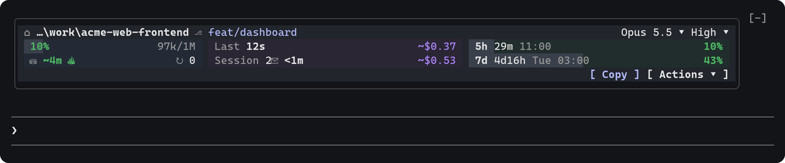
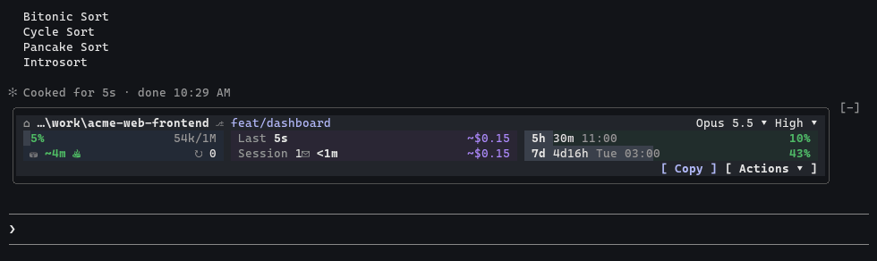
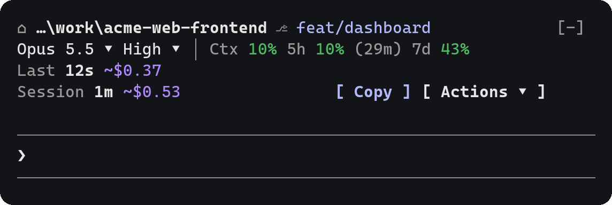
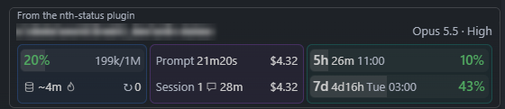
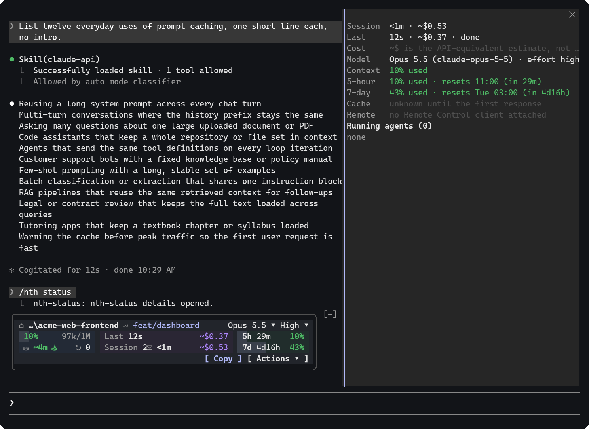
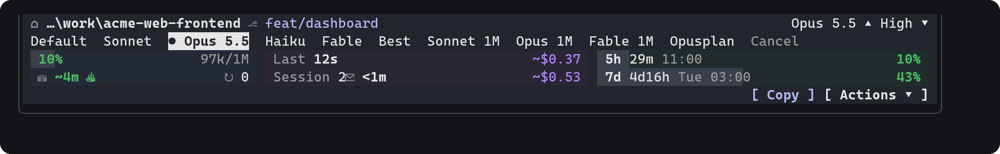

# nth-status

**A live session dashboard for Claude Code.** nth-status draws a compact,
color-coded panel above the prompt with your model and effort, context use,
5-hour and 7-day quotas, prompt cache countdown, prompt and session cost, and
quick actions, plus a `/nth-status` detail pane.

[](LICENSE)
[](#how-it-loads)
[](#requirements)



- [Demo](#demo) · [Features](#features) · [Screenshots](#screenshots)
- [Requirements](#requirements) · [Install](#install) · [Usage](#usage)
- [Configuration](#configuration) · [Update and uninstall](#update-and-uninstall)
- [Troubleshooting](#troubleshooting) · [Documentation](#documentation) · [License](#license)

## Demo

A real prompt running (`Prompt` counts up, then freezes as `Last` with its
cost), the Model and Effort pickers, and the Actions menu:



## Features

**At a glance**

- **Project:** working directory (shortened from the left), Git branch
  (`worktree`, `detached <sha>`), and `RC On` while a Remote Control client
  is attached.
- **Model and usage:** model and effort, context use with tokens, and the 5h
  and 7d subscription quotas with reset times, colored by severity.
- **Activity:** prompt cache countdown (`Warm`, `Expiring`, `Cold` only when
  confirmed), compactions, and the running or last prompt's duration and cost.
- **Session:** session duration, prompt count and cost, and the number of
  agents at work.

**Controls**

- **Model ▾ and Effort ▾ pickers** that switch the session model or effort.
- **`[ Copy ]`** copies the last response (the built-in `/copy` in the
  terminal).
- **`[ Actions ▾ ]`**: Copy code, Diff, Agents, Copy prompt, Session info.
- **`/nth-status`** opens a detail pane with every figure, reset times, cache
  details and each working agent.

**Adapts to the terminal**

- A three-zone dashboard where there is room, compact rows in narrow or short
  terminals, and fewer segments as the width shrinks.
- Colors follow Claude Code's dark and light themes; VS Code follows the
  editor theme.

**Observe-only**

- Never blocks or rewrites a prompt, tool call or model request, adds no
  prompt text, and makes no model call: it costs no tokens.
- Costs (`~$`) are the API-equivalent estimate from Claude Code's own cost
  ledger (`/cost`), not your bill.

## Screenshots

| Terminal, narrow (compact rows) | VS Code chat panel (read-only) |
|---|---|
|  |  |

The `/nth-status` detail pane, docked beside the transcript:



Captured from real Claude Code 2.1.312 sessions on Windows (terminal: dark
theme, a sample project; VS Code: the working-directory path is blurred).

## Requirements

| Surface | Status |
|---|---|
| Terminal CLI (Windows, macOS, Linux) | Full band and pane. Checked on Windows; macOS and Linux use the same mod API but have not been checked |
| VS Code extension chat panel | Read-only dashboard: no pickers or buttons ([details](docs/status-and-hooks.md#vs-code)) |
| Claude desktop app | Compact band and pane per the mod API; not verified |
| Headless `-p` / Agent SDK | Not drawn |

- Claude Code with mods support. Checked with 2.1.310 to 2.1.312.
- Optional: `sh` on `PATH` (Git Bash on Windows) for the
  [cache countdown status line](#cache-countdown-optional).

## Install

In Claude Code:

```text
/plugin marketplace add namth0712/nth-status
/plugin install nth-status@namth0712-nth-status
```

Pick a scope when asked (user scope installs it for every project). The
panel appears above the prompt. `claude plugin list` shows
`nth-status@namth0712-nth-status` as enabled.

From a shell, the same two steps are:

```sh
claude plugin marketplace add namth0712/nth-status
claude plugin install nth-status@namth0712-nth-status
```

### How it loads

nth-status is a Claude Code **mod packaged as a plugin**: a hooks module
that draws the band and the pane. Claude Code's plugin manager installs it
into `<config>/plugins/` and loads it in every session. It adds no skill,
tool or prompt text.

### Cache countdown (optional)

The exact prompt cache countdown comes from Claude Code's status line input,
and a plugin cannot set your `statusLine`. Without it, everything else works:
the terminal dashboard shows the mod's own estimate (`~4m`), while the
compact rows and the detail pane show no countdown. VS Code is unaffected.

If you have no `statusLine` yet, add this to `~/.claude/settings.json`:

```json
{
  "statusLine": {
    "type": "command",
    "command": "sh ~/.claude/plugins/marketplaces/namth0712-nth-status/scripts/nth-status-statusline.sh"
  }
}
```

- The script prints nothing. Like any custom status line, it leaves an empty
  row above the footer and hides footer hints such as `esc to interrupt`
  while a prompt runs.
- For another profile, replace `~/.claude` with that config home. Keep `~`
  unquoted; for a path with spaces, use `"$HOME/..."` instead.
- Already have a `statusLine`? Keep it; the countdown stays an estimate.
- Remove this entry before uninstalling nth-status or removing its
  marketplace: the script is removed with them.

### Moving from an earlier installation

Installations made with the earlier procedure or by nth-dev-kit load as
`nth-status@skills-dir`. To switch:

1. Install from the marketplace as above. The marketplace plugin takes
   precedence: `claude plugin list` shows the old copy as "Not loaded", so
   the panel never shows twice.
2. The earlier capture status line keeps working; nothing else changes.
3. Optional cleanup, in a session of that profile:

   ```text
   Follow "Disable" in ~/.claude/plugins/marketplaces/namth0712-nth-status/docs/installation.md.
   ```

   It removes the old copy and the status line it added (only if
   unchanged), and records an opt-out so nth-dev-kit does not install it
   again. Without it, the old copy stays shadowed while the marketplace
   plugin is installed (even when disabled), and loads again if you
   uninstall it. Add the [optional status line](#cache-countdown-optional)
   afterwards if you want the exact countdown.

nth-dev-kit installs its pinned nth-status into any profile without one on
record. On a profile that uses the marketplace plugin, run the Disable step
once so the kit leaves it alone.

## Usage

The panel updates on its own. Every control is a button:

| Action | How |
|---|---|
| Press a control | Click it, or focus it and press `Enter` |
| Focus the panel's controls | `Ctrl+X` then `Tab` |
| Move between controls | `Tab`, `←`, `→` |
| Return to the prompt | `Esc` |
| Open the detail pane | `/nth-status`, the agents count, or Actions → Agents |
| Close the detail pane | `Esc` |



- **Model ▾ / Effort ▾** open a row of choices with the current one marked
  `●`, then `Cancel`. A choice applies at once. Like typing `/model` or
  `/effort`, a Model pick also saves `model` in your user settings, and an
  Effort pick saves the level as that model's default.
- **`[ Copy ]`** runs the built-in `/copy` in the terminal. In the desktop
  app it copies the last completed response as Markdown.
- **`[ Actions ▾ ]`**: *Copy code* copies a code block from the last
  response (a choice row lists them when there are several), *Diff* runs
  `/diff`, *Agents* opens the detail pane, *Copy prompt* copies your last
  prompt, *Session info* copies a plain-text summary.
- **The folder** opens a row with the whole path and *Copy path*.

Severity colors: context turns yellow at 50 % and red at 80 %; the 5h and 7d
quotas at 60 % and 85 %. A figure shows `—` or stays hidden until Claude Code
reports it. nth-status never guesses.

More detail on every figure and control:
[docs/status-and-hooks.md](docs/status-and-hooks.md).

## Configuration

nth-status has no settings of its own. These change its behavior:

| Setting | Effect |
|---|---|
| The [optional status line](#cache-countdown-optional) | The exact cache countdown in the terminal |
| Your own `statusLine` | Kept as is; the band works, and the terminal cache countdown stays an estimate |
| `enabledPlugins["nth-status@namth0712-nth-status"]: false` | Turns the mod off without uninstalling (what `claude plugin disable` sets) |
| `promptCacheTtl: "1h"` | VS Code's cache estimate uses the one-hour TTL |
| `theme` (`/config`) | Terminal colors follow the dark and light theme families; other themes draw no tints |

### Multiple Claude profiles

Plugins are installed per config home (profile). Start Claude Code with that
profile, then run the [install](#install) commands there:

```sh
# macOS/Linux shells, Git Bash
CLAUDE_CONFIG_DIR="$HOME/.claude-work" claude
```

```powershell
# PowerShell
$env:CLAUDE_CONFIG_DIR = "$HOME\.claude-work"; claude
```

Profiles never share figures: each keeps its own quota readings and cache
data.

## Update and uninstall

Claude Code's plugin manager handles the lifecycle. The `/plugin` menu offers
the same actions as these commands:

| Task | Command |
|---|---|
| Update | `claude plugin marketplace update namth0712-nth-status`, then `claude plugin update nth-status@namth0712-nth-status`; start a new session or run `/reload-plugins` |
| Turn off for a while | `claude plugin disable nth-status@namth0712-nth-status` (and `enable` to turn it back on) |
| Uninstall | Remove the [optional status line](#cache-countdown-optional) if you added it, then `claude plugin uninstall nth-status@namth0712-nth-status` |
| Remove the marketplace | `claude plugin marketplace remove namth0712-nth-status` (this also uninstalls the plugin) |

Auto-update is off for third-party marketplaces; turn it on in `/plugin` →
Marketplaces if you want new releases automatically.

## Troubleshooting

| Problem | Try |
|---|---|
| No panel | `claude plugin list` in the same profile must show `nth-status@namth0712-nth-status` as enabled; start a new session or run `/reload-plugins` |
| 5h / 7d missing | They appear once a session of the same profile receives a quota reading (usually by its first response) and need a subscription login; API-key accounts report no quota |
| No exact cache countdown in the terminal | Add the [optional status line](#cache-countdown-optional); your own or a project `statusLine` takes its place |
| The panel shows twice, or an old copy loads | See [moving from an earlier installation](#moving-from-an-earlier-installation) |

More: [docs/troubleshooting.md](docs/troubleshooting.md).

## Documentation

| Document | Covers |
|---|---|
| [Legacy installation](docs/installation.md) | The earlier ownership-managed procedures (`nth-status@skills-dir`) that nth-dev-kit runs |
| [Status band reference](docs/status-and-hooks.md) | Every figure and control, the terminal and VS Code layouts, registered hooks |
| [Troubleshooting](docs/troubleshooting.md) | Missing panel or figures, known limits, procedure conflicts |
| [Architecture](docs/architecture.md) | Source layout, data sources, stored data |
| [Development](docs/development.md) | Tests, live testing, releasing |
| [Changelog](CHANGELOG.md) | Release history |

## License

Released under the [MIT License](LICENSE).
